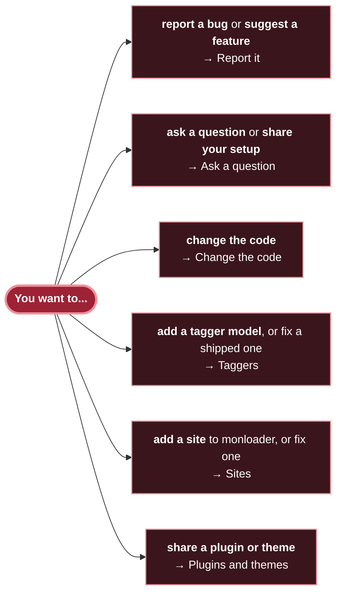
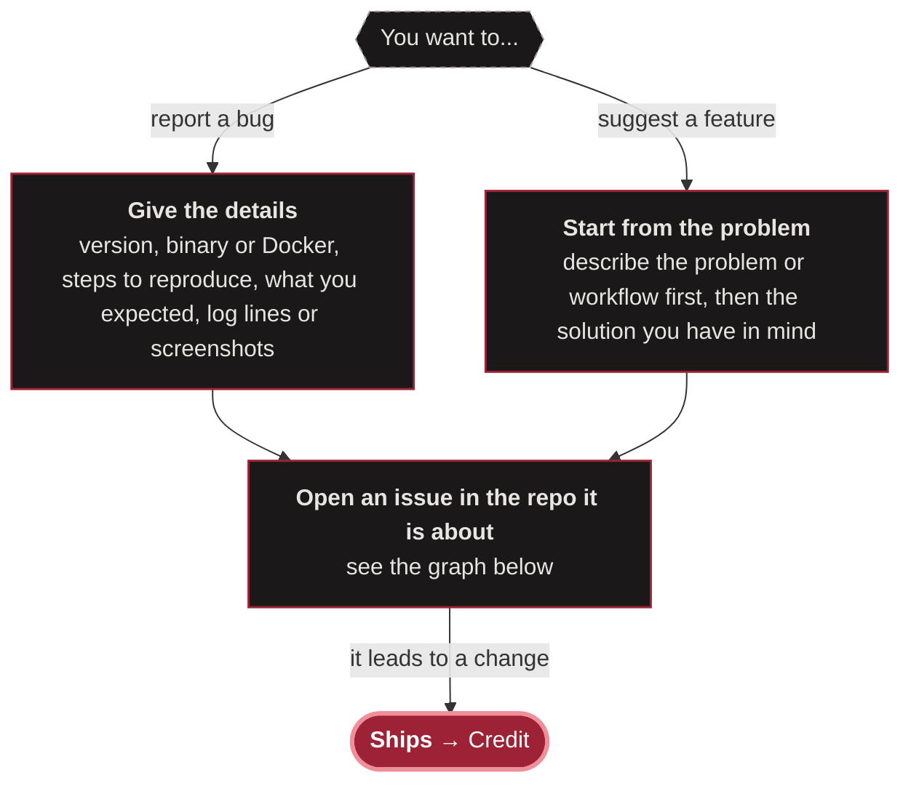
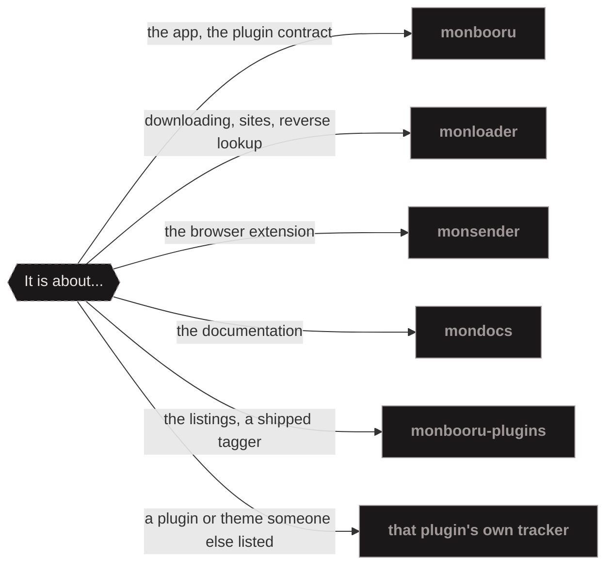
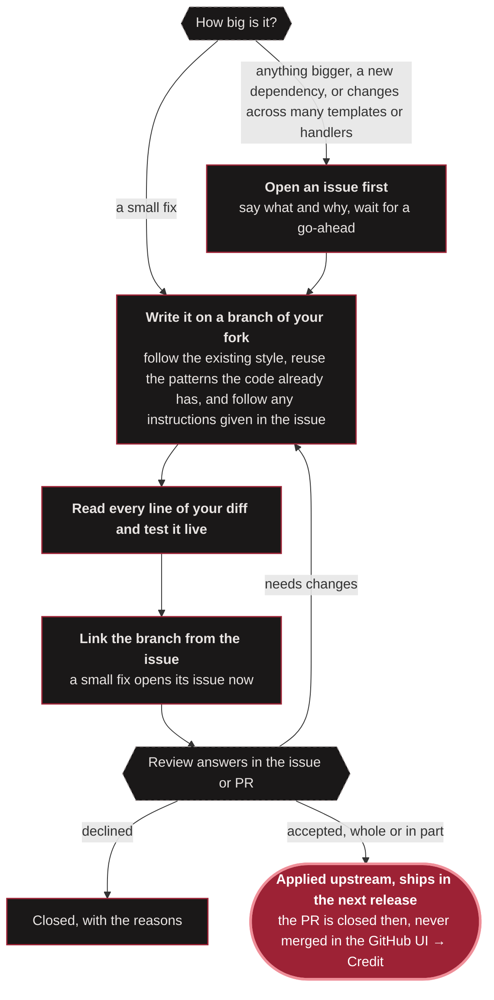
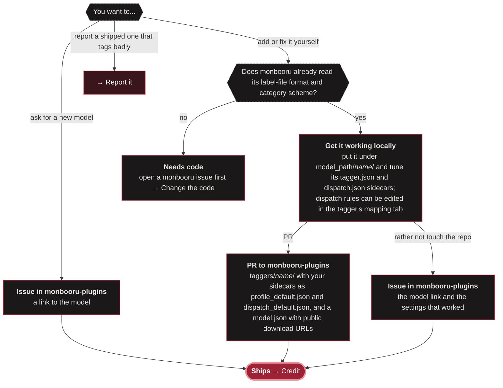
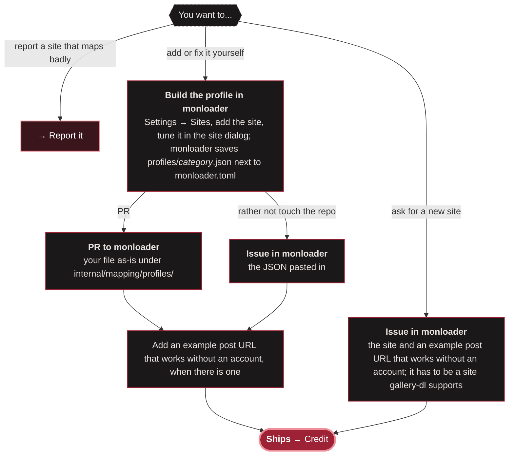
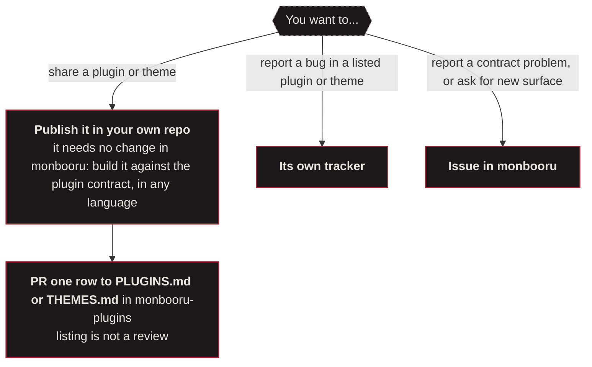
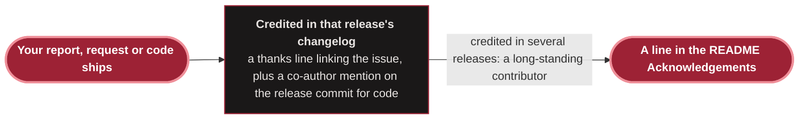

# Contributing

This file covers monbooru and its companion repos. Start from what you want to do and follow the arrows.

AI-generated contributions that their author has obviously not reviewed or put effort into are closed without review.

## Ask a question

Questions, workflows, setups and general talk go to [Discussions](https://github.com/monbooru/monbooru/discussions), for every repo. There is no Discord or other chat server, so answers stay public and the next person can find them.

## Report it

Repos: [monbooru](https://github.com/monbooru/monbooru) · [monloader](https://github.com/monbooru/monloader) · [monsender](https://github.com/monbooru/monsender) · [mondocs](https://github.com/monbooru/mondocs) · [monbooru-plugins](https://github.com/monbooru/monbooru-plugins)

References:

- [Troubleshooting (monbooru)](https://monbooru.github.io/mondocs/advanced/troubleshooting.html)
- [Troubleshooting (monsender)](https://monbooru.github.io/mondocs/addons/monsender/troubleshooting.html)

## Change the code

This repo publishes squashed release snapshots, which is why accepted work lands through a release rather than a merge.

References:

- [Building monbooru from source](https://monbooru.github.io/mondocs/advanced/building.html)
- [Building monloader from source](https://monbooru.github.io/mondocs/addons/monloader/development.html#building-from-source)
- [REST API and tokens](https://monbooru.github.io/mondocs/advanced/api.html)
- [monloader API and error codes](https://monbooru.github.io/mondocs/addons/monloader/development.html#api-tokens)

## Taggers

References:

- [TAGGERS.md: the model.json, profile and dispatch formats](https://github.com/monbooru/monbooru-plugins/blob/main/TAGGERS.md)
- [The shipped tagger folders, as examples](https://github.com/monbooru/monbooru-plugins/tree/main/taggers)
- [Your own models](https://monbooru.github.io/mondocs/advanced/auto-tagger.html#your-own-models)
- [Label rules (dispatch.json)](https://monbooru.github.io/mondocs/advanced/auto-tagger.html#label-rules-dispatchjson)
- [Auto-tagger guide: installing and tuning a model](https://monbooru.github.io/mondocs/guides/auto-tagger.html)

## Sites

References:

- [Site profiles: the file format](https://monbooru.github.io/mondocs/addons/monloader/development.html#site-profiles)
- [Editing a site's profile in the app](https://monbooru.github.io/mondocs/addons/monloader/guides/mapping.html#editing-a-sites-profile)
- [Setting up a site and its credentials](https://monbooru.github.io/mondocs/addons/monloader/guides/sites.html#setting-up-a-site)
- [The shipped profiles, as examples](https://github.com/monbooru/monloader/tree/main/internal/mapping/profiles)

## Plugins and themes

References:

- [Writing a plugin](https://monbooru.github.io/mondocs/advanced/api.html#writing-a-plugin)
- [Pairing](https://monbooru.github.io/mondocs/addons/pairing.html)
- [Plugins: button kinds and installing](https://monbooru.github.io/mondocs/addons/plugins.html)
- [Themes: making your own and the variables](https://monbooru.github.io/mondocs/advanced/themes.html)
- [simple-edit, an example plugin](https://github.com/monbooru/monbooru-plugins/tree/main/examples/simple-edit)
- [The shipped themes, as examples](https://github.com/monbooru/monbooru-plugins/tree/main/themes)

## Credit

## License

Contributions are accepted under the repository LICENSE.
