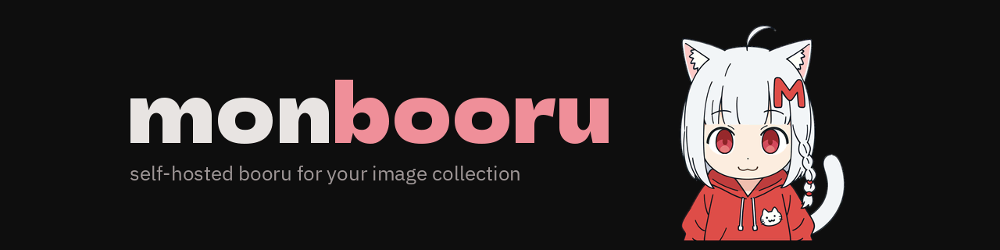
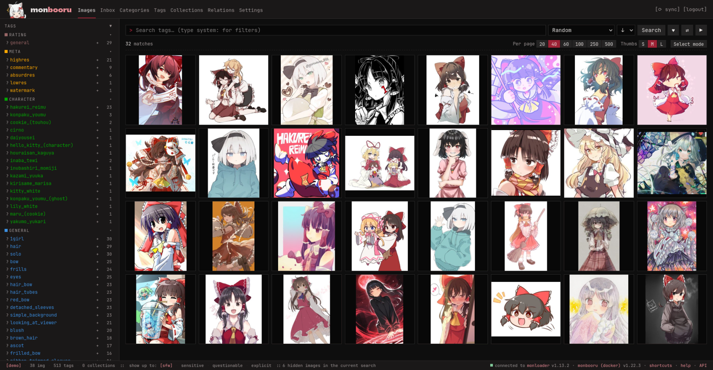
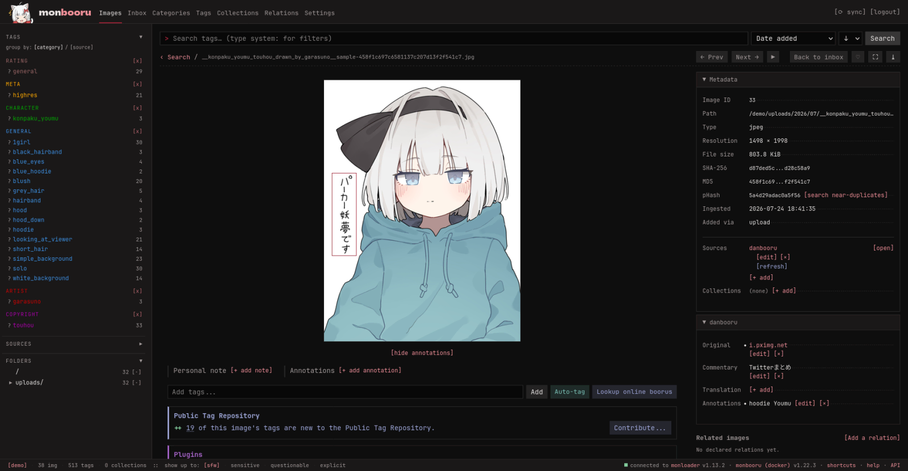
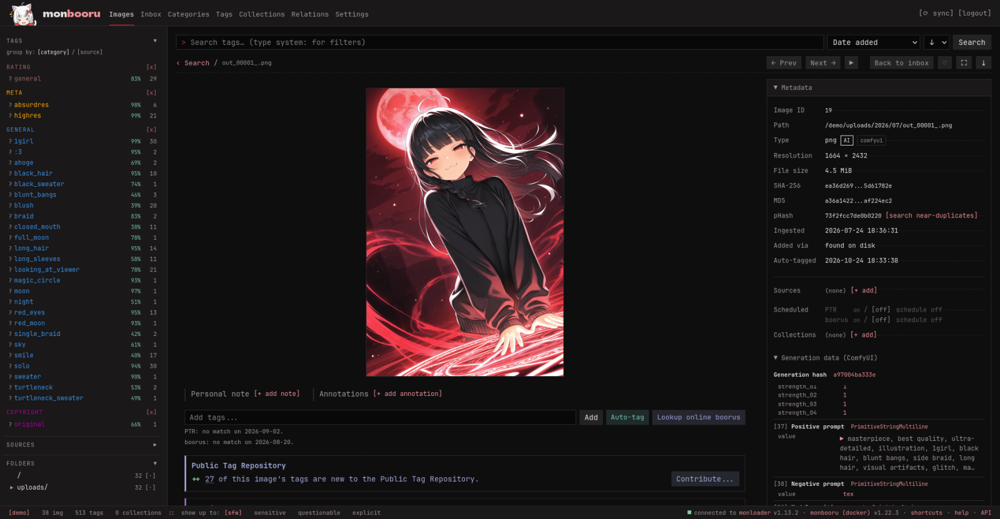
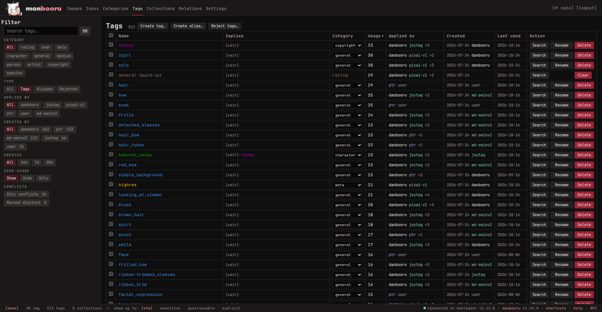
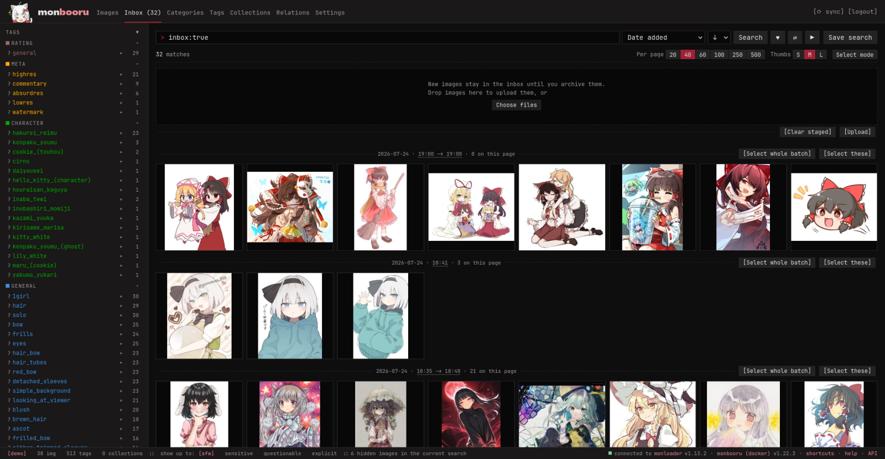
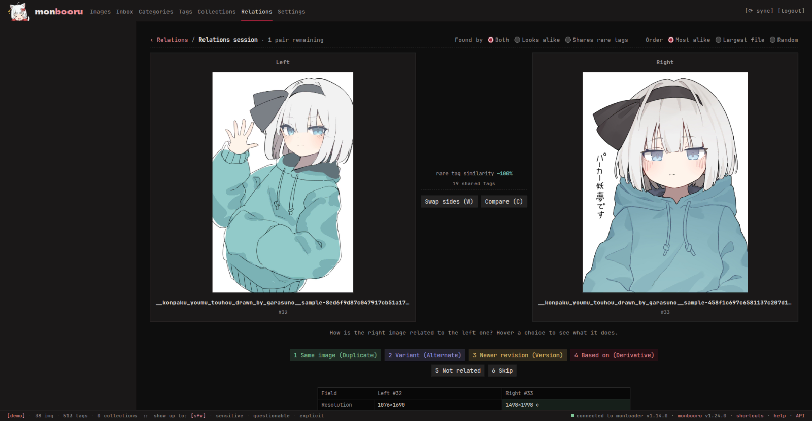
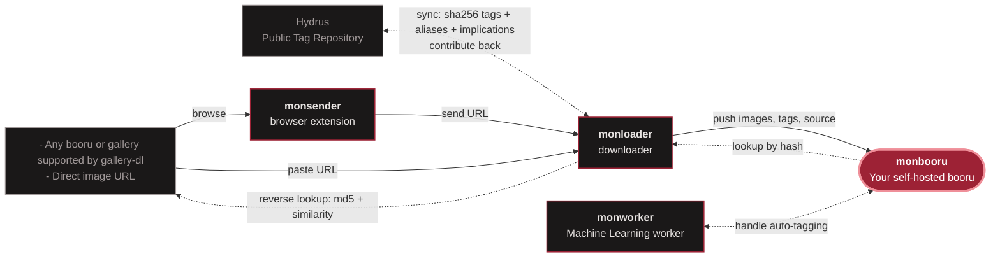

# 

Your own private, lightweight and fast booru: a Danbooru-style tag-based gallery for your local media.

Organize images, videos, animated GIFs and manga archives in one searchable library. Tag media by hand or automatically with local ONNX models (WD14, PixAI, etc.), manage tag relationships and provenance, and search by tags, metadata and more.
Monbooru is fully functional as a standalone application. The app itself never touches the internet; online features (downloading from boorus, reverse image lookup) are handled by [monloader](https://github.com/monbooru/monloader), while local and remote auto-tagging is available through [monworker](https://github.com/monbooru/monworker), both optional companions.

**[Demo](https://monbooru.github.io/demo/)** · **[Documentation](https://monbooru.github.io/mondocs/)** · **[Install](#install)** · **[Releases](https://github.com/monbooru/monbooru/releases)** · **[Changelog](CHANGELOG.md)**

<table>
  <tr>
    <td></td>
    <td></td>
  </tr>
  <tr>
    <td></td>
    <td></td>
  </tr>
  <tr>
    <td></td>
    <td></td>
  </tr>
</table>

## Features

### Library

- **Formats**: JPEG, PNG, WebP, AVIF, JPEG XL, GIF, MP4 and WebM, plus CBZ/ZIP archives read as a single item in a built-in manga reader
- **File watcher** that picks up new, moved and deleted files within seconds; browser upload; SHA-256 deduplication
- **File naming**: templates set the name and folder of incoming files, from their date, size, hash, origin and more; the same templates rename a selection, or the whole library in one pass
- **Inbox**: new images wait in the inbox until you've reviewed and tagged them
- **Scheduled maintenance**: a daily pass, each step optional, that syncs the gallery, auto-tags the new images, finds related images, and looks up sources through monloader
- **Multiple galleries** in one instance, each with its own folders and database; per-gallery export and import; transfer images from one gallery to another
- **Import** from supported booru applications

### Tags

- **Tag management**: merge duplicates, aliases, implications, custom categories, cleanup tools; a page per tag with your note, links and a usage graph
- **Tag provenance**: each tag remembers what applied it (you, an auto-tagger, a booru); view, map, search and remove tags by source, and reject a tag to keep it off every image
- **Rating tags** (general / sensitive / questionable / explicit), with a SFW ceiling in the footer that hides anything rated above it
- **Meta tags** set automatically from the file itself, under Danbooru's names: `highres`, `absurdres`, `animated`, `sound` and more
- **Local auto-tagging** with ONNX models (WD14 SwinV2, animetimm EVA02, JoyTag, Camie v2, PixAI, or any compatible model), on CPU or GPU; several models can run together, on videos and archive pages too

### Browse and search

- **Gallery** with folder tree, favorites, collections, related-image suggestions, animated previews on hover, and a fullscreen slideshow of a search or a selection
- **Search** with wildcards, OR, exclusions, saved searches, and filters on folder, date, size, dimensions, category, generation settings, and more
- **Batch operations** on a selection or a whole search: add or remove tags, rename, move, delete, auto-tag, set collection or source, download as a zip, and more
- **Keyboard-driven**: shortcuts on every page, from grid navigation to batch actions; press `?` in the app for the full list
- **On a phone**: layouts made for a small screen, and swipe between images

### Image details

- **Sources and provenance**: several sources per image, artist commentary, note boxes, and your own notes
- **Image relations**: duplicates, alternates, version chains, derivatives; near-duplicate detection with a side-by-side review and cleanup tools
- **AI generation metadata** from A1111/Forge and ComfyUI: prompts, models, seeds, full workflows

### Access and integrations

- **Optional password login**
- **REST API** with scoped tokens, an OpenAPI spec, and built-in docs
- **Plugins and themes**: drop one in the plugins or themes folder and turn it on in Settings; monbooru launches and supervises plugins for you
- **Downloads and reverse lookup** through the optional [monloader](#related-applications) companion

## Install

Monbooru runs on Linux (x86_64, arm64) and Windows (x86_64). Once started, it's at `http://localhost:8455`.

### Docker

Edit the volume paths in [`docker/docker-compose.yml`](docker/docker-compose.yml), then run `docker compose up -d`.

The standard images include monworker for local auto-tagging, except for `latest-lite` which requires a separate monworker instance that can run either locally or remotely. Auto-tagging is entirely optional.

For GPU-accelerated auto-tagging, use `latest-cuda` (NVIDIA GPUs) or `latest-openvino` (Intel GPUs). The default `latest` image supports CPU inference only.

### Download

Download a build for your system from the [releases](https://github.com/monbooru/monbooru/releases), unpack it, and run it; a browser opens on a short setup page.

Downloads come in two flavours:

- **lite**: Monbooru and ffmpeg only. Requires a separate monworker for auto-tagging.
- **bundled**: Includes monworker, so auto-tagging works out of the box.

Linux bundled builds are also available as an AppImage and Flatpak.

### Next steps

The [documentation](https://monbooru.github.io/mondocs/) covers the first steps.

## Warning

> **Intended for trusted local network use.** Monbooru is not designed to be exposed directly to the public internet. If you need remote access, use an appropriately secured private network.

## Technical overview

Monbooru is a single self-contained Go binary, web assets embedded, with six direct dependencies. Each gallery is one SQLite file: no database server, no cache layer, nothing else to run. Your images stay ordinary files and folders; the database and thumbnails live in a separate data directory, so backing up means copying that directory, and removing monbooru leaves your images where they were. The UI is server-rendered with htmx, with no JS framework and no frontend build step.

## Related applications

Monbooru works offline and on its own. These optional companions add the online features and auto-tagging:

- **monbooru**: this application; organizes, tags, and serves your collection.
- **[monloader](https://github.com/monbooru/monloader)**: downloader and online lookup companion. Fetches files and metadata from supported boorus and galleries through gallery-dl, then pushes them into Monbooru.
It also handles reverse image lookups through boorus, IQDB and SauceNAO, and synchronizes tags, aliases and implications with the Hydrus Public Tag Repository. When a matched post has a better-quality file, you can replace your local copy with one click.
- **[monsender](https://github.com/monbooru/monsender)**: browser extension; sends the URL of the page you're browsing to monloader.
- **[monworker](https://github.com/monbooru/monworker)**: Machine Learning worker; runs the auto-tagging models for monbooru, on the same machine or on another one.
- **[monbooru-plugins](https://github.com/monbooru/monbooru-plugins)**: community registry of plugins, themes and extra taggers.

## Contributing

Bug reports, ideas and pull requests are welcome.

See [CONTRIBUTING](CONTRIBUTING.md) for more information.

Bugs and feature requests go in the GitHub issue tracker.

Feel free to ask questions or discuss your setup in [Discussions](https://github.com/monbooru/monbooru/discussions), or on MonBooru Central, the community-run Discord. 

## License

[AGPL-3.0](LICENSE).

## Acknowledgements

These cover monbooru and its companion repos ([monloader](https://github.com/monbooru/monloader), [monworker](https://github.com/monbooru/monworker), [monsender](https://github.com/monbooru/monsender), [mondocs](https://github.com/monbooru/mondocs), [monbooru-plugins](https://github.com/monbooru/monbooru-plugins)).

Thanks to everyone listed in [CONTRIBUTORS](CONTRIBUTORS.md), whether they helped once or many times, and special thanks to [@gary-host-laptop](https://github.com/gary-host-laptop), [@CeareDelafont](https://github.com/CeareDelafont) and [@IkariDevGIT](https://github.com/IkariDevGIT) for their outstanding contributions.

Thanks to tamaki for the mon-chan visuals.

Thanks to [Danbooru](https://danbooru.donmai.us/) for shaping the booru style, and to [Hydrus Network](https://hydrusnetwork.github.io/hydrus/) a precursor in personal image and tag management that inspired monbooru.

This project is built on the work of others:

- [htmx](https://htmx.org/) powers the server-rendered UI.
- [SQLite](https://sqlite.org/), through the pure-Go [modernc.org/sqlite](https://gitlab.com/cznic/sqlite) driver, stores each gallery.
- [ONNX Runtime](https://onnxruntime.ai/), through [onnxruntime_go](https://github.com/yalue/onnxruntime_go), runs the auto-tagger in [monworker](https://github.com/monbooru/monworker). The supported models are the work of [SmilingWolf](https://huggingface.co/SmilingWolf) (WD SwinV2 v3), [animetimm](https://huggingface.co/animetimm) (EVA02), [fancyfeast](https://huggingface.co/fancyfeast) (JoyTag), [Camais03](https://huggingface.co/Camais03) (Camie Tagger v2), and [PixAI](https://huggingface.co/pixai-labs) (PixAI Tagger v1.0, in [noaione](https://huggingface.co/noaione)'s ONNX export).
- [ffmpeg](https://ffmpeg.org/) decodes video, AVIF and JPEG XL for thumbnails and hover previews; the bundled downloads carry a trimmed build of it from [ffmpeg-builds](https://github.com/monbooru/ffmpeg-builds), statically linked with [libwebp](https://chromium.googlesource.com/webm/libwebp), [dav1d](https://code.videolan.org/videolan/dav1d) and [libjxl](https://github.com/libjxl/libjxl).
- monloader is mostly a wrapper for [gallery-dl](https://github.com/mikf/gallery-dl), which does the actual scraping. Reverse lookups by image similarity are answered by [IQDB](https://iqdb.org/) and [SauceNAO](https://saucenao.com/); md5 lookups by the boorus themselves. The PTR tag lookup syncs against the [Hydrus Public Tag Repository](https://hydrusnetwork.github.io/hydrus/PTR.html) (PTR) via [Hydrus Network](https://github.com/hydrusnetwork/hydrus)'s repository protocol; the tags, aliases, and implications it serves are the work of the hydrus community.
- monsender's in-page image detection uses code from [ushiro](https://github.com/gary-host-laptop/ushiro) by gary-host-laptop and [behind!](https://github.com/kubuzetto/behind) by kubuzetto, originally under MPL-2.0.
- The mondocs site is built with [Hugo](https://gohugo.io/).

The full Go dependency lists are in each repo's `go.mod`.

The sample images in the screenshots, here, in the companion repos, and in the documentation, were downloaded from Danbooru and are the work of their respective artists, who retain all rights. They appear only to demonstrate the app; the repositories' license doesn't apply to them.
